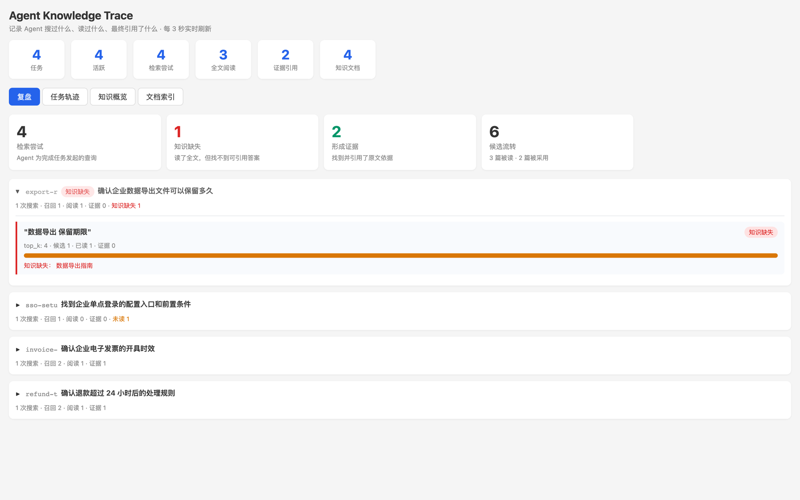
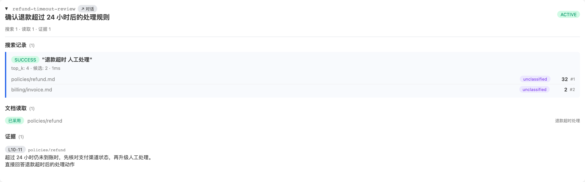

# Knowledge Retrieval MCP

> A flight recorder for how AI agents use your knowledge.

大多数知识库工具只告诉你“搜到了什么”。Knowledge Retrieval MCP 记录 Agent 为完成任务发起的每次检索、真正读过的文档，以及最终引用的原文证据。

当答案不理想时，你不必再猜：是查询没召回、Agent 没有阅读、文档内容不够，还是有依据却没有被采用。每一步都有记录，可以复盘，也可以据此持续改进知识库。



看板会自动区分“形成证据”和“读了全文但找不到答案”的任务，让知识缺口直接暴露出来。

## 它解决什么问题

- **观察**：知道 Agent 搜了什么、看了什么、最后用了什么。
- **复盘**：沿着任务还原 `检索 → 候选 → 阅读 → 引用` 的完整轨迹。
- **发现缺口**：把“读过文档但没有可引用答案”的情况标记为知识缺失。
- **持续改进**：区分检索问题、内容问题和 Agent 决策问题，而不是只看最终回答。
- **本地优先**：Markdown 知识库只读留在本机，Trace 写入本地 SQLite。

## 一条记录长什么样

```text
Task: 确认退款超过 24 小时后的处理规则
├── Search: "退款超时 人工处理"
│   └── Candidate #1: 退款超时处理
├── Read: policies/refund.md
└── Evidence: L10-L11
    "超过 24 小时仍未到账时，先核对支付渠道状态，再升级人工处理。"
```



## 工作方式

```text
Agent task
   ↓
search_knowledge ──→ 候选与排名
   ↓
read_knowledge   ──→ 实际阅读与版本变化
   ↓
cite_evidence    ──→ 最终采用的原文证据
   ↓
Trace Dashboard  ──→ 复盘、知识缺口与改进线索
```

## 快速开始

要求 Node.js >= 20。

```bash
git clone https://github.com/LucasJerryRoe/knowledge-retrieval-mcp.git
cd knowledge-retrieval-mcp/knowledge-retrieval-mcp
npm install
npm run build
```

详细配置、工具参数与看板使用方式见 [knowledge-retrieval-mcp/README.md](./knowledge-retrieval-mcp/README.md)。

## License

[MIT](./LICENSE)
